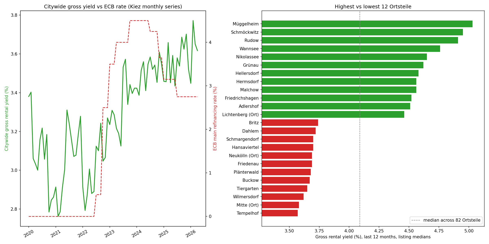

# Berlin Real Estate — Policy-Shock ETL, Geospatial ML & Price Prediction

[](https://github.com/Ehsan-Ghoreishi/berlin-real-estate-geospatial-analysis/actions/workflows/ci.yml)


[](LICENSE)

An end-to-end ETL pipeline and geospatial/time-series analysis of the Berlin
housing market (2020–2026): raw data → cleaning → geospatial feature
engineering → SQL storage → price prediction → policy-shock timeline →
buy-vs-rent yield analysis → interactive map.





## Pipeline

```
extract → transform → load → model → policy_analysis → yield_analysis → visualize
```

```bash
make install        # or: pip install -r requirements.txt
make run            # or: python3 main.py

python3 main.py --list                     # list stages
python3 main.py --stages model visualize   # run a subset, in pipeline order
```

Outputs land in `data/processed/` and `maps/`. A full run takes ~20s on
~89,000 combined listings. All seeds are fixed in `src/config.py`, so the
CSV outputs are reproducible run to run.

For a guided walkthrough of the results with charts, open
[`notebooks/berlin_market_analysis.ipynb`](notebooks/berlin_market_analysis.ipynb)
(rendered with outputs on GitHub; re-run with `make notebook`).

### Development

```bash
make install-dev    # dev deps + pre-commit hooks
make test           # pytest (21 tests)
make lint           # ruff check + ruff format --check
make typecheck      # mypy
```

CI runs lint, type checks and tests on every push and pull request.

## Dataset

**Source**: ["Berlin Real Estate: Sales & Rentals 2020-2026"](https://www.kaggle.com/datasets/sergionefedov/berlin-real-estate-sales-and-rentals-2020-2026)
by Sergey Nefedov (Apache 2.0 licence), downloaded from Kaggle. ~96,000
rows across 5 files, ~20 MB.

```bash
kaggle datasets download sergionefedov/berlin-real-estate-sales-and-rentals-2020-2026 \
    -p data/raw --unzip
```

**What's real vs. generated** (per the dataset's own documentation):

| Real | Generated |
|---|---|
| 82 Ortsteil centroids (OpenStreetMap admin boundaries) | Individual listing characteristics (rooms, floor, exact price) |
| 135 transit station coordinates (OSM / BVG / S-Bahn Berlin GmbH) | via a hedonic pricing model anchored to real EUR/m² medians |
| ECB main refinancing rate timeline, 2020–2026 | |
| German mortgage rate trajectory | |
| Real dates of Berlin housing-policy shocks (Mietendeckel, Heizungsgesetz, etc.) | |
| Real EUR/m² price *levels* per Ortsteil (anchored to ImmoScout24 / Engel & Völkers / Wertgutachten medians) | |

The dataset author chose this hybrid approach deliberately over scraping
ImmoScout24/Immowelt directly, which violates those platforms' ToS. This is
a materially stronger foundation than a fully synthetic dataset — the
geography, the macro shocks, and the price *levels* are real — but the
individual `price_eur` of any single row is model-generated, not an actual
transaction.

## What each stage does

| Stage | File | Description |
|---|---|---|
| **Extract** | `src/extract.py` | Validates the 5 raw CSVs (presence, required columns, row counts) — already downloaded from Kaggle into `data/raw/`. A missing column fails fast with a `SchemaError`. |
| **Transform** | `src/transform.py` | Cleans nulls/outliers (1st/99th percentile on €/m²), and — independently of the dataset's own `transit_distance_min` column — computes nearest-transit-station distance via a **GeoPandas + `scipy.cKDTree` nearest-neighbor search in a projected metric CRS (EPSG:25833)** against the 135 real station coordinates. Validates this independent computation against the dataset's provided walking-time column (Pearson r = 0.738) as a data-quality check. |
| **Load** | `src/load.py` | Persists all 5 cleaned tables (sales, rentals, new construction, monthly Kiez time series, stations) into one SQLite database with indexes. |
| **Model** | `src/model.py` | Linear Regression vs. Random Forest vs. Histogram Gradient Boosting predicting `price_eur` on the secondary-sales market from structural, building-quality, and macro features. Evaluated on a random 80/20 holdout, 5-fold cross-validation, and an out-of-time holdout (train 2020–2024, test 2025–2026). |
| **Policy analysis** | `src/policy_analysis.py` | Builds a listing-count-weighted citywide monthly price index from the 82-Ortsteil × 76-month time series and overlays it with the ECB rate and 7 real Berlin housing-policy events. |
| **Yield analysis** | `src/yield_analysis.py` | Gross rental yield and price-to-rent ratio: citywide over time (Kiez series) and per Ortsteil (listing-level medians, last 12 months). |
| **Visualize** | `src/visualize.py` | Folium interactive map (stratified 2,000-listing sample + all 135 real stations) and a static Matplotlib fallback map. |

## Results

**Price prediction (secondary market, n=49,000 after cleaning):**

| Model | Evaluation | RMSE (€) | MAE (€) | R² |
|---|---|---|---|---|
| Linear Regression | random 80/20 holdout | 99,186 | 68,061 | 0.820 |
| Linear Regression | 5-fold CV (mean ± std) | 98,954 ± 894 | — | 0.820 ± 0.002 |
| Linear Regression | out-of-time (2025+) | 103,180 | 69,203 | 0.823 |
| Random Forest | random 80/20 holdout | 77,081 | 49,908 | 0.891 |
| Random Forest | 5-fold CV (mean ± std) | 78,184 ± 1,575 | — | 0.888 ± 0.004 |
| Random Forest | out-of-time (2025+) | 81,902 | 51,886 | 0.888 |
| **Gradient Boosting** | random 80/20 holdout | **57,250** | **35,602** | **0.940** |
| Gradient Boosting | 5-fold CV (mean ± std) | 57,586 ± 1,082 | — | 0.939 ± 0.002 |
| Gradient Boosting | out-of-time (2025+) | 60,450 | 37,354 | 0.939 |

The CV spread is small, so the holdout score isn't a lucky split. On the
out-of-time test, RMSE rises ~6% (the model has never seen the 2025–26
price level) but R² holds, which suggests the model's ranking of
properties carries over to a period it never saw.

Both tree ensembles clearly beat the linear baseline — unlike on the
earlier synthetic prototype of this project, where a near-linear synthetic
price formula gave Linear Regression the edge. On real(er), richer hedonic
data, the nonlinear interactions the trees capture (energy class mattering more after the
2024 Heizungsgesetz, transit proximity mattering more in outer Bezirke than
central ones) actually show up — exactly the pattern predicted when this
project only had synthetic data to test on. Gradient boosting cuts RMSE
by a further 26% over the forest and is the saved model.

A randomized search (`make tune`, 15 candidates × 3-fold CV) did not beat
the hand-set gradient-boosting parameters on the holdout (57,739 vs
57,250 €), so they were kept; see `data/processed/tuning_results.json`.

**Top price drivers** (permutation importance on the gradient-boosting
model, drop in R² when a column is shuffled): living space (`area_m2`,
0.95), Bezirk (0.23), distance to Brandenburg Gate (0.19), renovation
condition (0.08), energy class (0.05), and the computed transit distance
(0.04).

**Policy-shock findings** (from `policy_analysis.py`):
- Average Kaltmiete rose from €11.73/m² pre-Mietendeckel-reversal to
  €12.96/m² in the 6 months after the April 2021 constitutional ruling —
  a +10.5% jump consistent with a suppressed-then-released price ceiling.
- Sales prices hit a local trough of €5,145/m² in August 2023, during the
  ECB's rate-hike cycle (peak rate 4.50% in October 2023) — before
  recovering as the ECB began cutting in mid-2024.

**Buy-vs-rent yield** (from `yield_analysis.py`):
- Citywide gross yield bottomed at 2.76% (Feb 2021, zero-rate era) and
  rose to ~3.6–3.8% by 2026, moving up alongside the 2022–23 ECB hike cycle.
- Across 82 Ortsteile (last 12 months, listing medians), gross yield
  ranges from 3.57% (Tempelhof) to 5.03% (Müggelheim); the outer
  south-east (Treptow-Köpenick) and outer Neukölln lead, while central
  and south-west premium areas (Mitte, Wilmersdorf, Dahlem) trail.
- **Data-quality finding:** within any month, the Kiez series has the
  *same* rent/price ratio in every Ortsteil (cross-sectional std ≈
  0.0008 pp), i.e. the generator derives Kiez rent from Kiez price. The
  per-Ortsteil ranking therefore uses the listing-level tables instead.

## Design decisions

- **Independent geospatial validation, not column reuse.** The dataset
  already ships a `transit_distance_min` column; the transform stage
  computes its own nearest-station distance from scratch using GeoPandas
  and a KD-tree in a proper projected CRS (EPSG:25833, UTM zone 33N — not
  raw lat/lon degrees, which distort distance) and checks it correlates
  with the provided column (r=0.738) rather than trusting the source
  blindly.
- **KD-tree over brute force.** The original synthetic prototype used
  brute-force nearest-station search (fine at 1,500×30 scale); at
  89,000×135 that would be far slower, so this version uses `scipy.cKDTree`
  — the appropriate escalation as scale grows, and a deliberate choice
  worth explaining if asked why the approach changed.
- **Listing-count-weighted time index**, not a naive mean of Ortsteil
  averages — a thin, low-liquidity Kiez shouldn't move the citywide index
  as much as a large one with hundreds of monthly listings.
- **Three evaluation views, not one.** A random split lets the model see
  neighbouring months of the same market regime; the out-of-time holdout
  is the honest test of whether it generalises forward in time.
- **Gradient boosting over a bigger forest** — the uncompressed Random
  Forest was 227 MB; shrinking it to fit GitHub cost accuracy. Histogram
  gradient boosting is both more accurate (R² 0.940 vs 0.891) and 0.7 MB
  on disk, with model-agnostic permutation importance replacing the
  forest's impurity importances for interpretability.
- **Generated artifacts are not versioned** — the SQLite DB, model and
  GeoPackage are rebuilt by `make run`; only source data, cleaned CSVs,
  metrics and charts are tracked.

## Project structure

```
berlin_real_estate/
├── main.py              # CLI entry point (--stages, --list)
├── Makefile
├── pyproject.toml       # ruff + pytest config
├── requirements.txt
├── requirements-dev.txt
├── src/
│   ├── config.py        # paths, seeds, CRS constants
│   ├── extract.py
│   ├── transform.py
│   ├── load.py
│   ├── model.py
│   ├── tune.py          # optional hyperparameter search
│   ├── policy_analysis.py
│   ├── yield_analysis.py
│   └── visualize.py
├── notebooks/           # executed analysis walkthrough
├── tests/               # pytest suite
├── .github/workflows/   # CI
├── data/
│   ├── raw/          # Kaggle source CSVs
│   └── processed/    # cleaned tables + metrics (DB, model, gpkg are rebuilt by `make run`)
└── maps/              # interactive + static maps, policy shock chart
```

## Next steps

- Extend the price model to the rental and new-construction segments.
- Publish the policy-shock notebook on Kaggle against the original
  dataset, crediting the source.

## License

Code: [MIT](LICENSE). Data: Apache 2.0, © Sergey Nefedov (see the Kaggle page).
