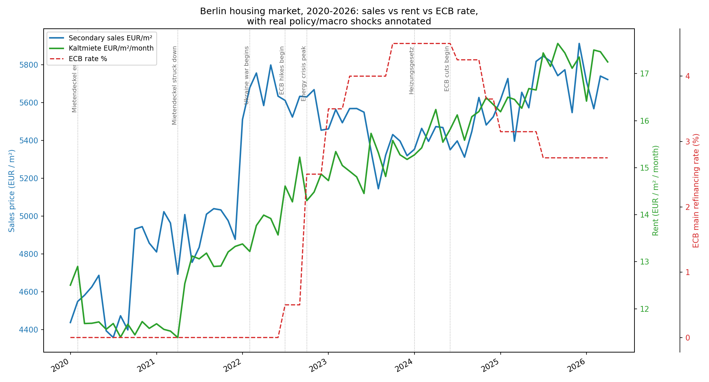
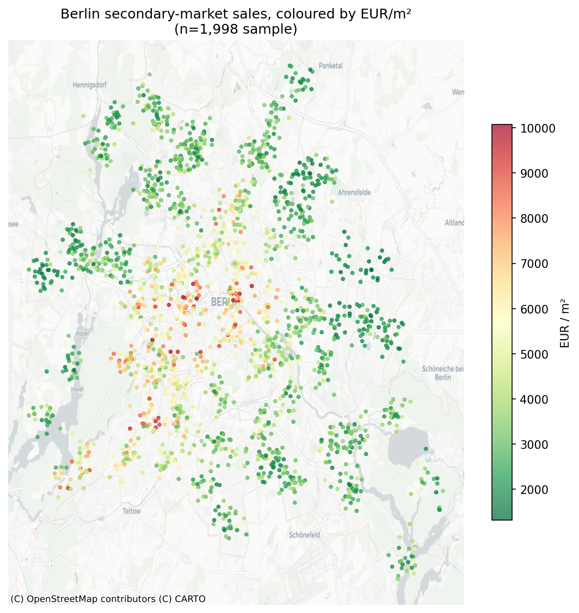

# Berlin Real Estate — Policy-Shock ETL, Geospatial ML & Price Prediction

An end-to-end ETL pipeline and geospatial/time-series analysis of the Berlin
housing market (2020–2026): raw data → cleaning → geospatial feature
engineering → SQL storage → price prediction → policy-shock timeline →
interactive map.




## Pipeline

```
extract → transform → load → model → policy_analysis → visualize
```

```bash
pip install -r requirements.txt
python3 main.py
```

Outputs land in `data/processed/` and `maps/`. Full run takes ~40s on
~89,000 combined listings.

## Dataset

**Source**: ["Berlin Real Estate: Sales, New Construction & Rentals
(2020–2026)"](https://www.kaggle.com/) by Sergey Nefedov, downloaded from
Kaggle. ~96,000 rows across 5 files, ~20 MB.

**What's real vs. generated** (per the dataset's own documentation — stated
here because every claim in this project needs to survive an interview
question):

| Real | Generated |
|---|---|
| 82 Ortsteil centroids (OpenStreetMap admin boundaries) | Individual listing characteristics (rooms, floor, exact price) |
| 135 transit station coordinates (OSM / BVG / S-Bahn Berlin GmbH) | via a hedonic pricing model anchored to real EUR/m² medians |
| ECB main refinancing rate timeline, 2020–2026 | |
| German mortgage rate trajectory | |
| Real dates of Berlin housing-policy shocks (Mietendeckel, Heizungsgesetz, etc.) | |
| Real EUR/m² price *levels* per Ortsteil (anchored to ImmoScout24 / Engel & Völkers / Wertgutachten medians) | |

The dataset author chose this hybrid approach deliberately over scraping
ImmoScout24/Immowelt directly, which violates those platforms' ToS. This is
a materially stronger foundation than a fully synthetic dataset — the
geography, the macro shocks, and the price *levels* are real — but the
individual `price_eur` of any single row is model-generated, not an actual
transaction. **Say this plainly if asked in an interview.**

## What each stage does

| Stage | File | Description |
|---|---|---|
| **Extract** | `src/extract.py` | Validates the 5 raw CSVs (row counts, presence) — already downloaded from Kaggle into `data/raw/`. |
| **Transform** | `src/transform.py` | Cleans nulls/outliers (1st/99th percentile on €/m²), and — independently of the dataset's own `transit_distance_min` column — computes nearest-transit-station distance via a **GeoPandas + `scipy.cKDTree` nearest-neighbor search in a projected metric CRS (EPSG:25833)** against the 135 real station coordinates. Validates this independent computation against the dataset's provided walking-time column (Pearson r = 0.738) as a data-quality check. |
| **Load** | `src/load.py` | Persists all 5 cleaned tables (sales, rentals, new construction, monthly Kiez time series, stations) into one SQLite database with indexes. |
| **Model** | `src/model.py` | Linear Regression vs. Random Forest predicting `price_eur` on the secondary-sales market from structural, building-quality, and macro features. Evaluated with RMSE/MAE/R² on a held-out split. |
| **Policy analysis** | `src/policy_analysis.py` | Builds a listing-count-weighted citywide monthly price index from the 82-Ortsteil × 76-month time series and overlays it with the ECB rate and 7 real Berlin housing-policy events. |
| **Visualize** | `src/visualize.py` | Folium interactive map (stratified 2,000-listing sample + all 135 real stations) and a static Matplotlib fallback map. |

## Results

**Price prediction (secondary market, n=49,000 after cleaning):**

| Model | RMSE (€) | MAE (€) | R² |
|---|---|---|---|
| Linear Regression | 99,186 | 68,061 | 0.820 |
| Random Forest | 77,081 | 49,908 | **0.891** |

Random Forest clearly outperforms here — unlike on the earlier synthetic
prototype of this project, where a near-linear synthetic price formula gave
Linear Regression the edge. On real(er), richer hedonic data, the nonlinear
interactions Random Forest captures (energy class mattering more after the
2024 Heizungsgesetz, transit proximity mattering more in outer Bezirke than
central ones) actually show up — exactly the pattern predicted when this
project only had synthetic data to test on.

**Top price drivers** (Random Forest feature importance): living space
(`area_m2`, 61%), then distance to Brandenburg Gate (13%), then building
age, Bezirk (Steglitz-Zehlendorf and Charlottenburg-Wilmersdorf both command
a premium), computed transit distance, and renovation condition.

**Policy-shock findings** (from `policy_analysis.py`):
- Average Kaltmiete rose from €11.73/m² pre-Mietendeckel-reversal to
  €12.96/m² in the 6 months after the April 2021 constitutional ruling —
  a +10.5% jump consistent with a suppressed-then-released price ceiling.
- Sales prices hit a local trough of €5,145/m² in August 2023, during the
  ECB's rate-hike cycle (peak rate 4.50% in October 2023) — before
  recovering as the ECB began cutting in mid-2024.

## Design decisions worth defending in an interview

- **Independent geospatial validation, not column reuse.** The dataset
  already ships a `transit_distance_min` column; the transform stage
  computes its own nearest-station distance from scratch using GeoPandas
  and a KD-tree in a proper projected CRS (EPSG:25833, UTM zone 33N — not
  raw lat/lon degrees, which distort distance) and checks it correlates
  with the provided column (r=0.738) rather than trusting the source
  blindly.
- **KD-tree over brute force.** The original synthetic prototype used
  brute-force nearest-station search (fine at 1,500×30 scale); at
  89,000×135 that would be far slower, so this version uses `scipy.cKDTree`
  — the appropriate escalation as scale grows, and a deliberate choice
  worth explaining if asked why the approach changed.
- **Listing-count-weighted time index**, not a naive mean of Ortsteil
  averages — a thin, low-liquidity Kiez shouldn't move the citywide index
  as much as a large one with hundreds of monthly listings.
- **Random Forest over a deeper model** — higher interpretability via
  `feature_importances_`, appropriate given the dataset's actual
  nonlinearities without the overfitting risk of a much deeper model.
- **`joblib` model compression** — the uncompressed Random Forest was
  227 MB (over GitHub's 100 MB file limit); reducing `n_estimators` from
  300→150 and `max_depth` from 18→14, plus `compress=3`, brought it to
  14.8 MB with R² moving by less than 0.006 — a good example of a
  practical trade-off between artifact size and model quality.

## Project structure

```
berlin_real_estate/
├── main.py
├── requirements.txt
├── src/
│   ├── extract.py
│   ├── transform.py
│   ├── load.py
│   ├── model.py
│   ├── policy_analysis.py
│   └── visualize.py
├── data/
│   ├── raw/          # Kaggle source CSVs
│   └── processed/    # cleaned tables, SQLite DB, trained model, metrics
└── maps/              # interactive + static maps, policy shock chart
```

## Next steps

- Extend the price model to the rental and new-construction segments
  (rent-yield / buy-vs-rent comparison by Ortsteil).
- Hyperparameter search (`GridSearchCV`) on the Random Forest.
- Publish the policy-shock notebook on Kaggle against the original
  dataset, crediting the source.
